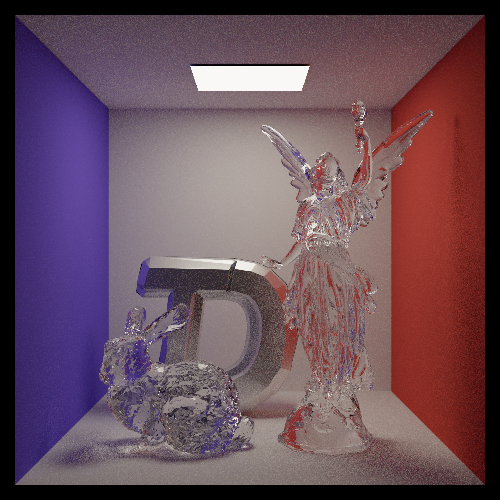
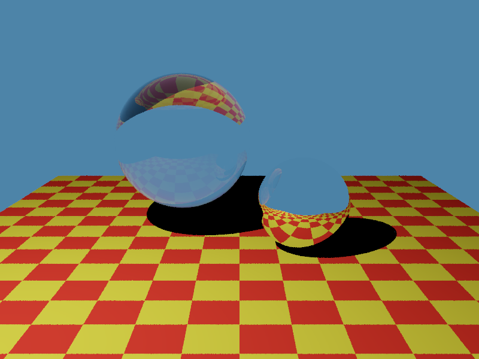
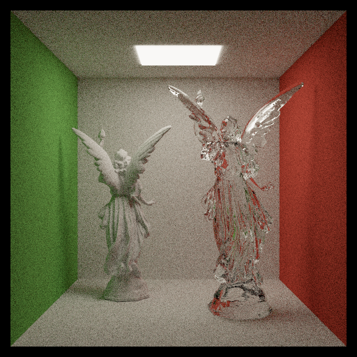
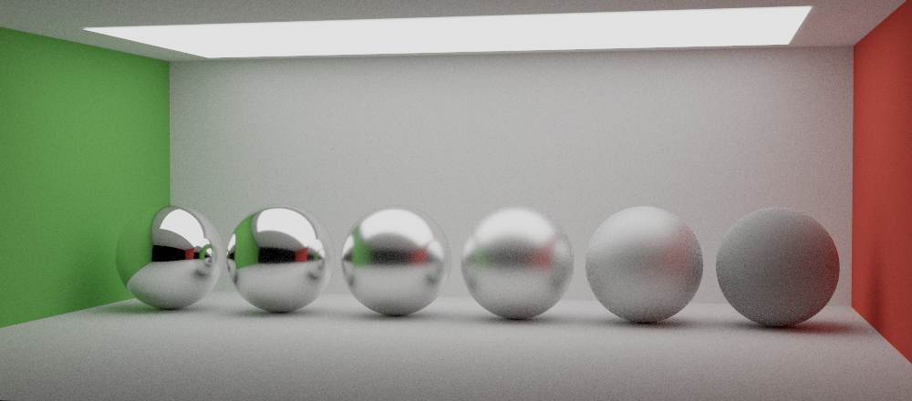
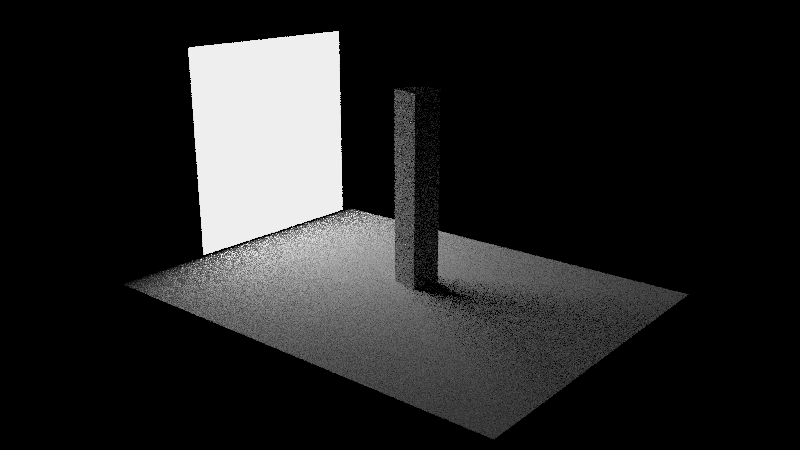

# TDSG Renderer

<p align="center">
  
</p>

TDSG Renderer，一个基于物理的渲染器。它面向 TDS 游戏开发社团图形组的教学。

> 承蒙老师的支持和信任，TDSG Renderer 将同时作为成都信息工程大学《计算机图形学》官方课程的实验，落地时间和形式待定。

## Features

- [ ] Integrator
    - [x] Whitted-style
    - [x] Brute-force Path Tracing
    - [x] PT + NEE
    - [x] PT + MIS
    - [ ] BDPT
    - [ ] Photon Mapping
- [ ] 材质系统：
    - [x] Diffuse
    - [x] Mirror
    - [x] Dielectric
    - [x] Microfacet (Cook-Torrance, GGX)
    - [ ] Kulla-Conty approximation
    - [ ] Kajiya-Kay
- [ ] 光源：
    - [x] point light
    - [x] spotlight
    - [x] area light
    - [ ] 环境光（infinity area light）
- [x] BVH 加速结构
- [ ] 纹理映射
- [ ] denoiser
- [x] PCG 随机数生成器
- [x] 多线程
- [x] GPU 加速（OptiX 后端，见下文）
- [x] 光谱渲染
- [ ] 解析外部场景 
- [ ] 参与介质（体渲染）

## 构建与运行
通过 `CMakeLists.txt` 的 `TDSG_SPECTRAL` 切换光谱 / RGB 渲染，默认 `OFF`（RGB 渲染）。

Windows：你需要 Visual Studio 26 工具链 + CMake。

macOS：你需要 clang (安装 Xcode commandline tools) + CMake。

首次配置：
```powershell
cmake -S . -B build
```

Debug 构建：
```powershell
cmake --build build --config Debug --parallel
```

Release 构建：
```powershell
cmake --build build --config Release --parallel
```

首次使用请先运行 `./tdsg_render --help` 浏览一下基本功能。

## OptiX 后端（可选）

默认构建只包含 CPU 后端。GPU 后端需要 CUDA Toolkit 与 OptiX SDK
（CUDA 13.5 + OptiX 9.1 已验证），并通过 `-DTDSG_OPTIX=ON` 打开：

```powershell
cmake -S . -B build-optix -G Ninja -DCMAKE_BUILD_TYPE=Release `
      -DTDSG_OPTIX=ON `
      -DTDSG_OPTIX_SDK_DIR="G:/MySDK/OptiX/OptiX SDK 9.1.0"
cmake --build build-optix --parallel
```

设备端程序由 `nvcc` 直接编译成 PTX（`build-optix/tdsg_optix.ptx`），C++ 部分仍然使用
原来的编译器，因此 CPU 构建完全不受影响。Windows 上 `nvcc` 需要 `cl.exe`：如果它不在
`PATH` 里，可通过 `-DTDSG_OPTIX_HOST_COMPILER=<包含 cl.exe 的目录>` 指定。

渲染：

```powershell
./tdsg_render --scene lucy --integrator mis --spp 64 --backend optix
```

- `--backend cpu|optix` 切换后端，`--device N` 选择 CUDA 设备（默认 0）。
- 支持的积分器：`path`、`nee`、`mis`、`normal`（`whitted` 仅 CPU）。
- 三角形走硬件求交，球体走自定义求交程序；两者各自一个 GAS，再由一层 IAS 组合。
  着色代码逐行对应 CPU 版本并使用相同的 PCG 随机数流，因此同 `--seed` 下两种后端
  的结果在统计上一致（互反射/玻璃场景存在正常的蒙特卡洛噪声差异）。


## 示例场景

- Whitted

命令：`./tdsg_render --scene whitted --integrator whitted`

<p align="center">
  
</p>

- Cornell Box

命令：`./tdsg_render --scene cornell --integrator nee --spp 16`
<p align="center">
  
</p>


- Cornell Box + 玻璃球

命令：`./tdsg_render --scene cornell_glass --integrator path --spp 2048 --depth 16`
<p align="center">
  
</p>


- Cornell with TDS

命令：`./tdsg_render --scene cornell_glass --integrator path --spp 1024 --depth 8 --obj ../../assets/tdsg.obj --obj-scale 0.7 --obj-rotate-y 25 --obj-translate -0.34 0.64 0.5`
<p align="center">
  
</p>

- Lucy

命令：`./tdsg_render --scene lucy --integrator mis --spp 400`
<p align="center">
  
</p>

- Holy TDS

命令：`./tdsg_render --scene tds --integrator mis --spp 384`
<p align="center">
  
</p>


- The Veach Test Scene

命令：`./tdsg_render --scene veach --integrator mis --spp 16`
<p align="center">
  
</p>

- 粗糙度测试

命令：`./tdsg_render --scene roughness_test --integrator path --spp 512`
<p align="center">
  
</p>

- 面光测试（方便对比 BSDF sampling 和 light sampling）

命令：`./tdsg_render --scene area_light --integrator nee --spp 4`
<p align="center">
  
</p>

这几个示例场景都是硬编码的，构建器位于 `src/scene/make_scene.cpp`，可能日后考虑加入 JSON / xml 解析外部场景描述文件。
