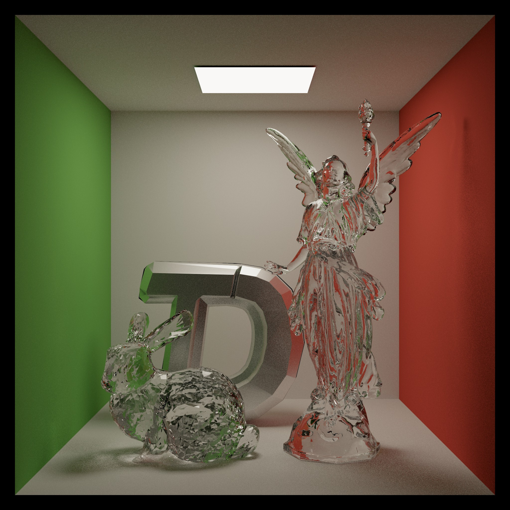
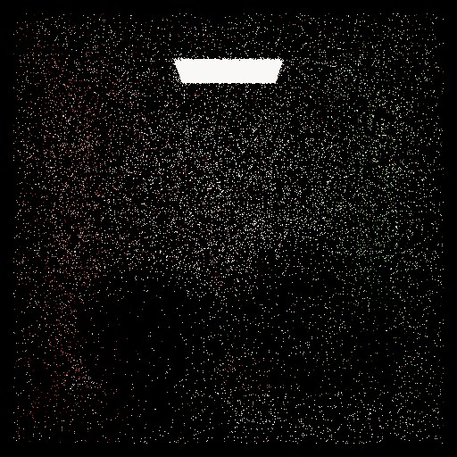
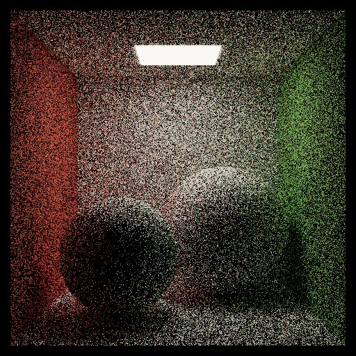
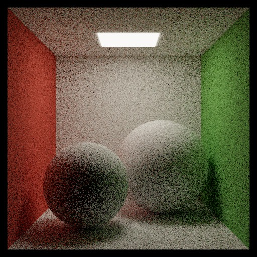
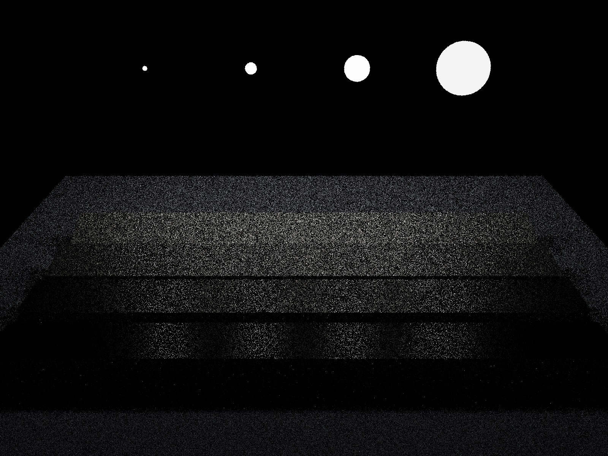
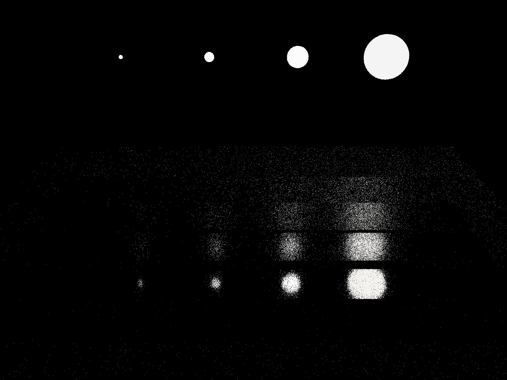
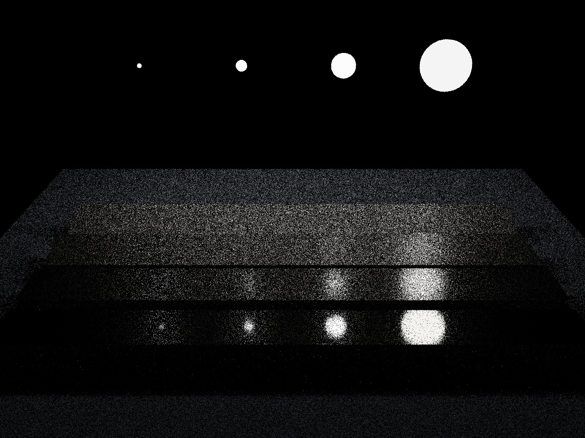
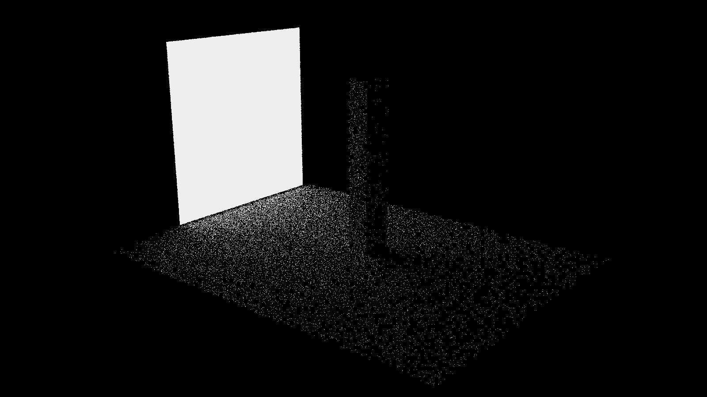
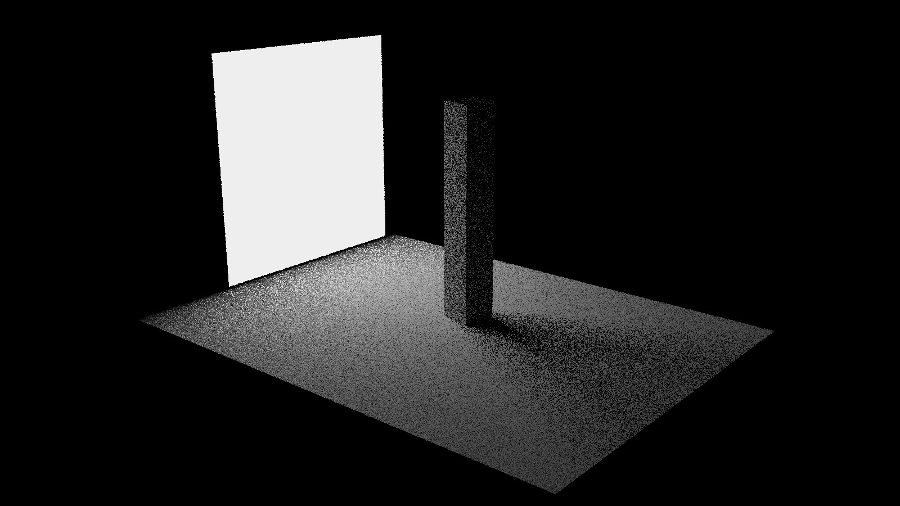

# TDSG Renderer

<p align="center">
  
</p>

TDSG Renderer，一个基于物理的渲染器。它面向 TDS 游戏开发社团图形组的教学。

> 承蒙老师的支持和信任，TDSG Renderer 将同时作为成都信息工程大学《计算机图形学》官方课程的实验，落地时间和形式待定。

## Features

- [ ] Integrator
    - [x] Whitted-style
    - [x] Brute-force Path Tracing
    - [x] PT + NEE
    - [x] PT + MIS
    - [ ] BDPT
    - [ ] Photon Mapping
- [ ] 材质系统：
    - [x] Diffuse
    - [x] Mirror
    - [x] Dielectric
    - [x] Microfacet (Cook-Torrance, GGX)
    - [ ] Kulla-Conty approximation
    - [ ] Kajiya-Kay
- [ ] 光源：
    - [x] point light
    - [x] spotlight
    - [x] area light
    - [ ] 环境光（infinity area light）
- [x] BVH 加速结构
- [ ] 纹理映射
- [ ] denoiser
- [x] PCG 随机数生成器
- [x] 多线程
- [ ] GPU 加速（CUDA 后端）
- [x] 光谱渲染
- [ ] 解析外部场景 
- [ ] 参与介质（体渲染）

## 构建与运行
通过 `CMakeLists.txt` 的 `TDSG_SPECTRAL` 切换光谱 / RGB 渲染，默认 `OFF`（RGB 渲染）。

Windows：你需要 Visual Studio 26 工具链 + CMake。

macOS：你需要 clang (安装 Xcode commandline tools) + CMake。

首次配置：
```powershell
cmake -S . -B build
```

Debug 构建：
```powershell
cmake --build build --config Debug --parallel
```

Release 构建：
```powershell
cmake --build build --config Release --parallel
```

首次使用请先运行 `./tdsg_render --help` 浏览一下基本功能。


## 示例场景

- Whitted

命令：`./tdsg_render --scene whitted --integrator whitted`

<p align="center">
  
</p>

- Cornell Box

命令：

`./tdsg_render --scene cornell --integrator path --spp 1`（ 1 ray/pixel ）

`./tdsg_render --scene cornell --integrator path --spp 16`（ 16 rays/pixel ）

`./tdsg_render --scene cornell --integrator path --spp 128`（ 128 rays/pixel ）

|  |  |  |
|:--:|:--:|:--:|
| 1spp | 16spp | 128spp |


- Cornell Glass

命令：

`./tdsg_render --scene cornell_glass --integrator path --spp 2048 --depth 16`（Cornell Glass）

`./tdsg_render --scene cornell_glass --integrator path --spp 1024 --depth 8 --obj ../../assets/tdsg.obj --obj-scale 0.7 --obj-rotate-y 25 --obj-translate -0.34 0.64 0.5`（Cornell with TDS）

|  |  |
|:--:|:--:|
| Cornell Glass | Cornell with TDS |

- The Veach Test Scene

命令：

`./tdsg_render --scene veach --integrator nee --spp 1`（Light sampling）

`./tdsg_render --scene veach --integrator path --spp 1`（BSDF sampling）

`./tdsg_render --scene veach --integrator mis --spp 1`（MIS）

|  |  |  |
|:--:|:--:|:--:|
| 光源采样 | BSDF 采样 | 多重重要性采样 |

- Lucy

命令：

`./tdsg_render --scene lucy --integrator mis --spp 400`（Lucy）

`./tdsg_render --scene tds --integrator mis --spp 2048 --depth 32`（Holy TDS）

|  |  |
|:--:|:--:|
| Lucy | Holy TDS |


- 粗糙度测试

命令：`./tdsg_render --scene roughness_test --integrator path --spp 512`
<p align="center">
  
</p>

- 面光测试

命令：

`./tdsg_render --scene area_light --integrator path --spp 1`（Naive PT）

`./tdsg_render --scene area_light --integrator nee --spp 1`（+NEE）

|  |  |
|:--:|:--:|
| 暴力路径追踪 | 路径追踪 + NEE |


这几个示例场景都是硬编码的，构建器位于 `src/scene/make_scene.cpp`，可能日后考虑加入 JSON / xml 解析外部场景描述文件。
