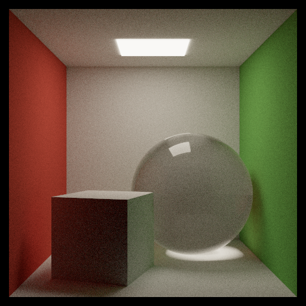
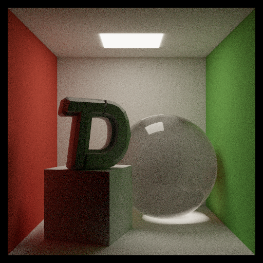
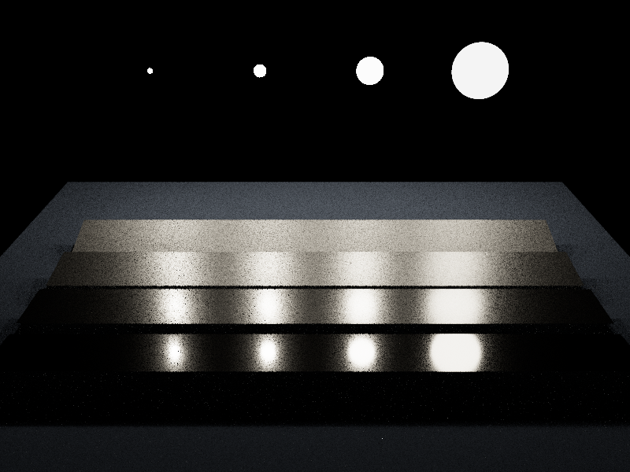

# TDSG Renderer
TDSG Renderer，一个基于物理的渲染器。面向 TDS 游戏开发社团图形组的教学。

## Features

- [ ] Integrator
    - [x] Whitted-style
    - [x] Path Tracing (+ MIS, NEE)
    - [ ] BDPT
    - [ ] Photon Mapping
- [ ] 材质系统：
    - [x] Diffuse
    - [x] Mirror
    - [x] Dielectric
    - [x] Microfacet (Cook-Torrance, GGX)
    - [ ] Kulla-Conty approximation
    - [ ] Kajiya-Kay
- [ ] 光源：
    - [x] point light
    - [x] spotlight
    - [x] area light
    - [ ] 环境光（infinity area light）
- [x] BVH 加速结构
- [ ] 纹理
- [ ] denoiser
- [x] PCG 随机数生成器
- [x] 多线程
- [ ] 解析外部场景 
- [ ] 参与介质（体渲染）

## 构建与运行

Windows：你需要 Visual Studio 26 工具链 + CMake。

macOS：你需要 clang (安装 Xcode commandline tools) + CMake。

首次使用请先运行 `./tdsg_render --help` 浏览一下基本功能。

## 示例场景

- Cornell Box

命令：`./tdsg_render --integrator path --spp 2048 --depth 16`

  

- Cornell with TDS

命令：`./tdsg_render --integrator path --spp 1024 --depth 8 --obj ../../assets/tdsg.obj --obj-scale 0.7 --obj-rotate-y 25 --obj-translate -0.34 0.64 0.5`

  

- The Veach Test Scene

命令：`./tdsg_render --scene veach --integrator path --spp 64 --depth 4`

  

`cornell` 和 `veach` 两个基础场景都是程序化产生的（硬编码），构建器位于 `src/scene/make_scene.cpp`，可能日后考虑加入 JSON / xml 解析外部场景描述文件。
